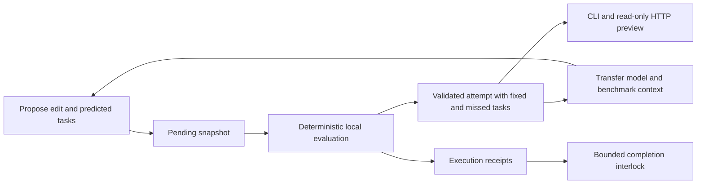

# Self-Improvement Memory

A runnable local lab for preserving why an agent harness changed, what an edit
was predicted to fix, and what it actually fixed. The history follows the
harness into a new model and benchmark setting so failed predictions remain
available alongside successful edits.

The experiment creates a prediction snapshot **before** each evaluation, runs
deterministic in-process operations, and records successes, failures, selection,
model, and benchmark. Identical root-cause text shares one problem entry. The
second attempt inherits the first history and adds a requirement the original
completion gate cannot satisfy.

## Run

Python 3.10 or newer; no packages, API keys, shell tools, or services required.

```powershell
python -B app.py demo
python -B -m unittest -v
python -B app.py serve --port 8883
```

Open <http://127.0.0.1:8883/>. `/record.json` returns the complete experiment,
including both pending prediction snapshots; `/health` is a health check.
To validate a saved **memory object**, use `python -B app.py validate record.json`.
The command accepts the `memory` object inside a demo report, not the full report.

Expected scenario score: **5/6**. The cap-without-evidence case intentionally
fails. The transferred attempt scores **5/7** because its additional independent
verifier requirement also fails. These outcomes are examples, not measurements
of a language model.

## Code map

| Source | Responsibility |
| --- | --- |
| `sim.py` | Validates records, freezes predictions through a two-phase API, merges identical diagnoses, transfers provenance, and implements the completion interlock and explicit execution receipts. |
| `scenarios.py` | Runs fixed local arithmetic/list fixtures, exercises failure branches, and builds source/target attempt histories. |
| `app.py` | CLI, saved-record validation, HTML renderer, and read-only HTTP routes bound to loopback. |
| `test_memory.py` | Regression tests for branch ordering, receipt semantics, prediction immutability, malformed records, scoring, transfer, and HTTP routes. |
| `requirements.txt` | Documents the standard-library-only dependency boundary. |
| `.gitignore` | Excludes interpreter caches, local environments, data, and generated JSON/logs. |



## Record and gate semantics

The record follows the schematic structure in Appendix D.3 of
[Self-Improvement Memory Enables Continual Recursive Self-Improvement](https://arxiv.org/html/2611.18856v1).
This implementation adds explicit pending/evaluated status, task outcomes, and
model/benchmark fields. Predictions can only be set when proposing; evaluating
an attempt requires exactly its planned task set and boolean results. Snapshots
are independent copies. Import validates all fields and score consistency.
This API prevents accidental backfilling; it is not a tamper-proof audit log.

The gate independently recreates the simplified Appendix F.2 branch order:
rejection cap, terminal error, pending confirmation, previous parse error,
discarded commands, low execution count, then acceptance. The rejection budget
counts rejections over this small session; it does not reset. Every fixture uses
a fresh gate. The cap permits completion even when evidence is absent; a pending
confirmation may also pass without additional execution. Both are deliberate
limitations of this bounded heuristic.

The paper's simplified code infers execution from command text. Here operations
run in-process and issue explicit receipts: **executed** and **successful** have
different counts. A failed operation still counts as executed. A trusted caller
supplies the terminal-error signal; receipts alone cannot establish task quality.
The gate is diagnostic middleware, not a permission or correctness boundary.

No arbitrary commands, tmux transport, model calls, self-editing agent, real
benchmark runner, or learned optimizer is implemented. The paper's parser and
transport fragments concern separate repairs and are outside this record/gate
experiment. No reported research scores or model-transfer gains are reproduced.
